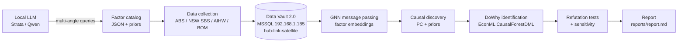

# nsw-crime-causal

**LLM-assisted causal discovery and inference on New South Wales crime rates.**

Because NSW open data does **not** publish individual-level offender attributes
(age, gender, education of offenders), this project builds an *area-level*
causal model of recorded crime using factors discovered by a **local LLM**
(Qwen served via Strata) from publicly available research findings and public
datasets (ABS Census / Labour Force / SEIFA, NSW SBS, AIHW, BOM, NSW open
data). Raw factor values live in a **Data Vault 2.0** relational model
(hubs / links / satellites) on **MSSQL** on the LAN. Before any factor enters
the causal model it is embedded with a **Graph Neural Network** (message
passing over the factor graph). Causal structure is learned with the **PC
algorithm** merged with literature priors, then effects are identified and
estimated with **DoWhy** and **EconML** (CausalForestDML), and stress-tested
with DoWhy **refutation** tests.

Full methodology: [docs/METHODOLOGY.md](docs/METHODOLOGY.md).
Critical self-evaluation (strengths / weaknesses / improvement roadmap):
[docs/SELF_EVALUATION.md](docs/SELF_EVALUATION.md).
Founding requirements (original prompt + traceability):
[docs/ORIGINAL_PROMPT.md](docs/ORIGINAL_PROMPT.md).

## Pipeline



## Repository layout

```
sql/ (packaged: src/nsw_causal/sql)   Data Vault 2.0 DDL + views (MSSQL)
src/nsw_causal/
  config.py            pydantic-settings (env / .env)
  db/                  pyodbc + SQLAlchemy, hub/link/satellite repository
  llm/                 OpenAI-compatible client, prompts, discovery loop
  factors/             catalog schema (pydantic), CSV + synthetic panel loaders
  gnn/                 factor graph, message-passing GNN, embeddings + clusters
  causal/              PC discovery, DoWhy/EconML estimation, refutation
  reporting/           markdown + figures
  cli.py               `nswcausal` entry point
tests/                 unit tests (no DB / no LLM needed)
docs/METHODOLOGY.md    full methodology write-up
docs/SELF_EVALUATION.md  strengths / weaknesses / improvement roadmap
docs/ORIGINAL_PROMPT.md  founding prompt + requirement traceability
```

## Prerequisites

- Python **3.11** recommended (3.10+; econml wheels lag new Python releases).
- **ODBC Driver 18 for SQL Server** installed on the machine running the pipeline.
- MSSQL `DataVault` database reachable at `192.168.1.185,1433`
  (login `ai` — see `.env.example`; create a dedicated login with
  `db_owner` on `DataVault` only).
- Optional: local LLM endpoint (Strata serving `qwen3.8-flash-next`,
  OpenAI-compatible `/v1`).
- Optional GPU: RTX 5080 (Blackwell) needs a **cu128** PyTorch build:
  `pip install torch --index-url https://download.pytorch.org/whl/cu128`.

## Quickstart

```powershell
cd nsw-crime-causal
python -m venv .venv ; .\.venv\Scripts\Activate.ps1
pip install -U pip
pip install torch --index-url https://download.pytorch.org/whl/cu128   # GPU build
pip install -e ".[all,dev]"
copy .env.example .env

# offline demo (synthetic panel with planted effects, no DB, no LLM):
nswcausal run-all --synthetic

# production run:
nswcausal init-db
nswcausal discover-factors --use-llm
nswcausal load-data --csv data/raw/panel.csv --use-db
nswcausal embed --use-db
nswcausal discover-causal
nswcausal estimate --refute
nswcausal report
```

Outputs land in `artifacts/` (catalog, panel, embeddings, DAG, effects,
refutation) and `reports/report.md` (+ figures).

## The Data Vault model (schema `dv`)

| Layer | Tables | Role |
|---|---|---|
| Hub | `HUB_FACTOR`, `HUB_REGION`, `HUB_PERIOD`, `HUB_DATASET` | business keys, MD5 hash keys |
| Link | `LINK_OBSERVATION` (factor x region x period x dataset), `LINK_FACTOR_RELATION` (factor graph edges) | relationships |
| Satellite | `SAT_FACTOR`, `SAT_OBSERVATION` (raw values), `SAT_REGION`, `SAT_FACTOR_EMBEDDING` (GNN vectors as JSON) | versioned attributes via `LOAD_DTS` + `HASHDIFF`, insert-only |

Consumption views: `V_FACTOR_PANEL`, `V_FACTOR_META`, `V_FACTOR_RELATIONS`,
`V_FACTOR_EMBEDDINGS`.

## How the GNN is used

Nodes are **factors** (not regions). Edges come from the LLM/literature prior
plus empirical Spearman correlation. A GraphSAGE-style message-passing network
is trained self-supervised on link prediction + feature reconstruction; the
resulting embeddings (a) cluster near-duplicate proxies so adjustment sets use
one representative per cluster instead of collinear duplicates, and (b) are
persisted to `SAT_FACTOR_EMBEDDING` for reuse. This follows the CFR-GNN design
notes in this workspace (pure PyTorch, no PyTorch-Geometric dependency).

## Publishing to GitHub

```powershell
git init -b main
git add .
git commit -m "Initial commit: LLM+GNN+DataVault causal pipeline for NSW crime"
git remote add origin https://github.com/<you>/nsw-crime-causal.git
git push -u origin main
```

CI (`.github/workflows/ci.yml`) runs ruff + pytest (CPU torch) on every push.
**Never commit `.env`** — it is git-ignored; put secrets in GitHub Actions
secrets if you extend CI to touch the database.

## Honest limitations

- Area-level (ecological) analysis: no individual offender data exists in NSW
  open data, so results describe **places**, not people.
- Recorded crime is partly a function of policing and reporting behaviour.
- LLM-proposed factors/edges are a *prior* to be reviewed by a domain expert,
  not evidence.
- Causal claims hold only under the stated DAG assumptions (no unmeasured
  confounding, correct lag structure); see the methodology doc.

## License

MIT
